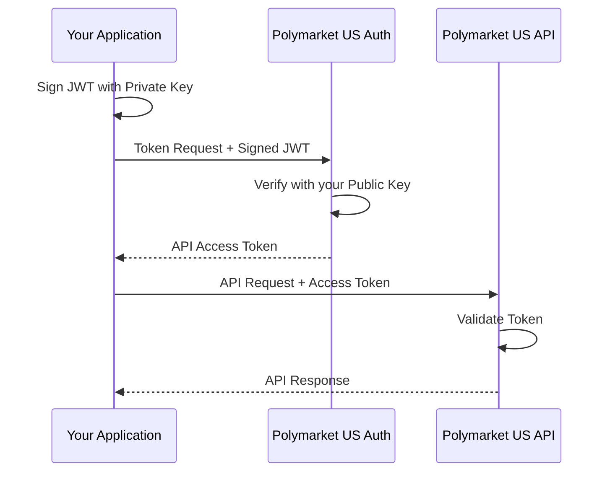

> ## Documentation Index
> Fetch the complete documentation index at: https://docs.polymarket.us/llms.txt
> Use this file to discover all available pages before exploring further.

# Authentication

> High-level overview of Private Key JWT authentication for partners, with the partner-specific details and a pointer to the full implementation guide.

The Polymarket US API uses **Private Key JWT** authentication with RSA keys — the **same mechanism used across the platform**, including by institutional traders. You sign a JWT with your RSA private key and exchange it for a short-lived access token.

> **[Full authentication guide](https://docs.polymarket.us/trader-guide/authentication.md)**
>
> Key generation, JWT claims, code samples (Python, Go, curl), key rotation, troubleshooting, and the complete scope reference live in the **Institutional API → Getting Started** guide. This page covers what's specific to partners and links you there for the implementation details.

> [!NOTE]
>
> Your RSA key pairs are generated during [Partner Onboarding](https://docs.polymarket.us/partners/get-connected/onboarding.md) — you share only the **public** keys with Polymarket US and keep the private keys secure.

## How it works



1. **Create a signed JWT assertion** — sign a JWT with your private key.
2. **Exchange it for an access token** — send the assertion to the token endpoint.
3. **Call the API with the access token** — include it as a `Bearer` token on each request.

The [full guide](https://docs.polymarket.us/trader-guide/authentication.md) has the exact JWT claims, token request, and ready-to-use Python and Go clients.

## Environments

| Environment | Auth Domain | API Domain |
| - | - | - |
| Pre-production | `pmx-preprod.us.auth0.com` | `api.preprod.polymarketexchange.com` |
| Production | `pmx-prod.us.auth0.com` | `api.prod.polymarketexchange.com` |

> [!NOTE]
>
> Use `https://[API Domain]` for both the JWT audience claim and the API base URL. Each environment requires separate onboarding — pre-production credentials do not work in production.

## Prerequisites

After completing [Partner Onboarding](https://docs.polymarket.us/partners/get-connected/onboarding.md), you will have everything you need to authenticate:

| You have | From onboarding |
| - | - |
| Private key file | Generated by you (keep secure) |
| Client ID | Provided by Polymarket US in your shared Google Drive folder |
| Auth Domain & API Audience | See [Environments](#environments) above |

## Acting on behalf of a participant

This is the main partner-specific difference. You authenticate **once as your Firm**, then act on behalf of the Retail Participants you onboard by including the **`x-participant-id`** header on account-scoped requests (trading, positions, reports):

```bash theme={null}
curl -X GET "https://api.preprod.polymarketexchange.com/v1/whoami" \
  -H "Authorization: Bearer YOUR_ACCESS_TOKEN" \
  -H "x-participant-id: firms/ISV-Participant-YourISV/users/participant-123"
```

Use [`GET /v1/users`](https://docs.polymarket.us/institutional/accounts/overview#endpoints) to discover the participant IDs your Firm may act on behalf of. See [Participants](https://docs.polymarket.us/partners/onboarding/users.md) for how to resolve identities, and [Accounts & Identity](https://docs.polymarket.us/trader-guide/accounts-identity.md) for the full hierarchy.

## Scopes

Your application is granted **scopes** that control which endpoints you can call. The scopes most relevant to partners include:

| Scope | Grants |
| - | - |
| `read:kyc` / `write:kyc` | View KYC status; start verification and manage webhooks |
| `read:accounts` | View identities (`/v1/whoami`, `/v1/users`) and accounts |
| `read:orders` / `write:orders` | View and place/cancel/modify orders |
| `read:positions` | Positions, balances, and balance/position ledgers |
| `read:funding` / `write:funding` | View funding; create transfers |

> [!NOTE]
>
> The **authoritative scope list and the full scope-by-endpoint mapping** are maintained in the [full authentication guide](https://docs.polymarket.us/trader-guide/authentication.md#api-scopes). Missing a required scope returns `403 Forbidden` (REST) / `PERMISSION_DENIED` (gRPC).

## Next steps

> **[Full authentication guide](https://docs.polymarket.us/trader-guide/authentication.md)**
>
> JWT claims, code samples, key rotation, and troubleshooting.

> **[Partner Onboarding](https://docs.polymarket.us/partners/get-connected/onboarding.md)**
>
> Get your keys registered and receive your Client ID.

> **[Quickstart](https://docs.polymarket.us/partners/get-connected/quickstart.md)**
>
> Authenticate and place your first order end to end.

> **[Troubleshooting](https://docs.polymarket.us/trader-guide/authentication-troubleshooting.md)**
>
> Resolve common authentication errors.


This documentation is built and hosted on [Mintlify](https://mintlify.com), a developer documentation platform.