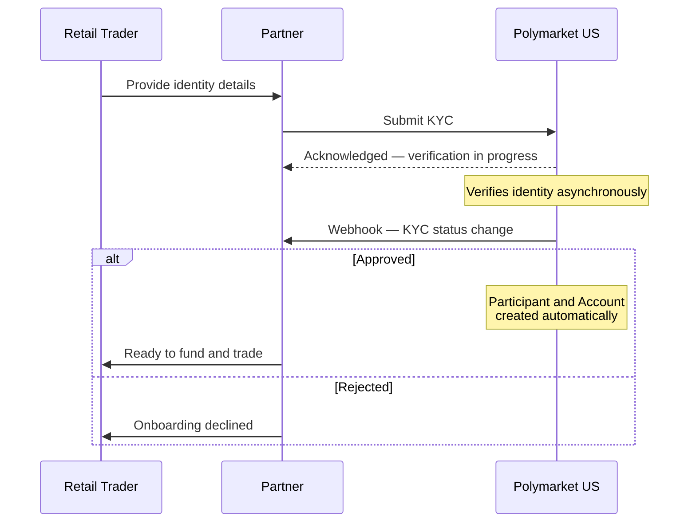

> ## Documentation Index
> Fetch the complete documentation index at: https://docs.polymarket.us/llms.txt
> Use this file to discover all available pages before exploring further.

# Onboard Participants

> How a retail trader becomes a tradable Participant: KYC is the onboarding process, and a Participant and Account are created automatically on approval.

Onboarding a retail trader onto your platform **is the KYC process**. You collect the trader's required information and submit it; Polymarket US performs the identity verification and makes the decision. When KYC is approved, a **Participant** (their trading identity) and an **Account** (their balances and positions) are **created automatically** — there is no separate "create user" or "create account" step.

This section has three parts that fit together:

> **[KYC Verification](https://docs.polymarket.us/partners/onboarding/kyc/overview.md)**
>
> **The process.** Collect and submit identity information; Polymarket US verifies and decides.

> **[Participants](https://docs.polymarket.us/partners/onboarding/users.md)**
>
> **The identity created.** The trading identity you act on behalf of after approval.

> **[Accounts](https://docs.polymarket.us/partners/onboarding/accounts.md)**
>
> **The account created.** The container for the participant's balances and positions.

## How they fit together

KYC verification is **asynchronous**: you submit the participant's information, and Polymarket US notifies your platform of the decision via a **webhook**. On approval, the Participant and Account already exist and are ready for funding and trading.

1. **You collect** each trader's required details and present the appropriate participant agreement.
2. **You submit** the information through the [KYC](https://docs.polymarket.us/partners/onboarding/kyc/overview.md) endpoints.
3. **Polymarket US verifies** the identity asynchronously and makes the decision — you do not perform the verification yourself.
4. **You're notified by [webhook](https://docs.polymarket.us/partners/onboarding/kyc/webhooks.md)** when the outcome is terminal. On approval, the `kyc.approved` event carries the participant's `provisioned_account` and `provisioned_participant` once the trading account is provisioned (provisioning is asynchronous, so this can arrive shortly after the initial response).
5. **On approval**, the trader's [Participant](https://docs.polymarket.us/partners/onboarding/users.md) identity and [Account](https://docs.polymarket.us/partners/onboarding/accounts.md) are already provisioned. Once their account is funded with a [deposit transfer](https://docs.polymarket.us/partners/funding/deposits-withdrawals.md) *(Beta)*, they can trade.

> [!TIP]
>
> **Prefer the webhook over polling.** Register a [KYC webhook](https://docs.polymarket.us/partners/onboarding/kyc/webhooks.md) so your platform is informed the moment a decision is made. An `ACCEPT` decision means the Participant and Account are provisioned for you with no separate setup call, but provisioning is asynchronous: their identifiers arrive on the [`kyc.approved`](https://docs.polymarket.us/partners/onboarding/kyc/webhooks) event (which can follow shortly after the initial response), so don't assume they're on the first response. You can still fall back to `GET /v1/kyc/status` for one-off checks.

> [!NOTE]
>
> **One process, two results.** Think of KYC as the onboarding action and the Participant and Account as its outputs. You never create them directly — a successful KYC produces both.

## Where to go next

> **[Start with KYC](https://docs.polymarket.us/partners/onboarding/kyc/overview.md)**
>
> The verification workflow and document verification.

> **[Set up status webhooks](https://docs.polymarket.us/partners/onboarding/kyc/webhooks.md)**
>
> Receive the async KYC decision instead of polling.

> **[Act on participants](https://docs.polymarket.us/partners/onboarding/users.md)**
>
> Resolve who you can act for and use the `x-participant-id` header.

> **[Funding](https://docs.polymarket.us/partners/funding/overview.md)**
>
> How an approved participant's account is funded *(Beta)*.

> **[End-user legal agreements](https://docs.polymarket.us/partners/onboarding/legal-agreements.md)**
>
> The four documents each trader accepts, the exact acceptance language, and agreement versioning.

This documentation is built and hosted on [Mintlify](https://mintlify.com), a developer documentation platform.