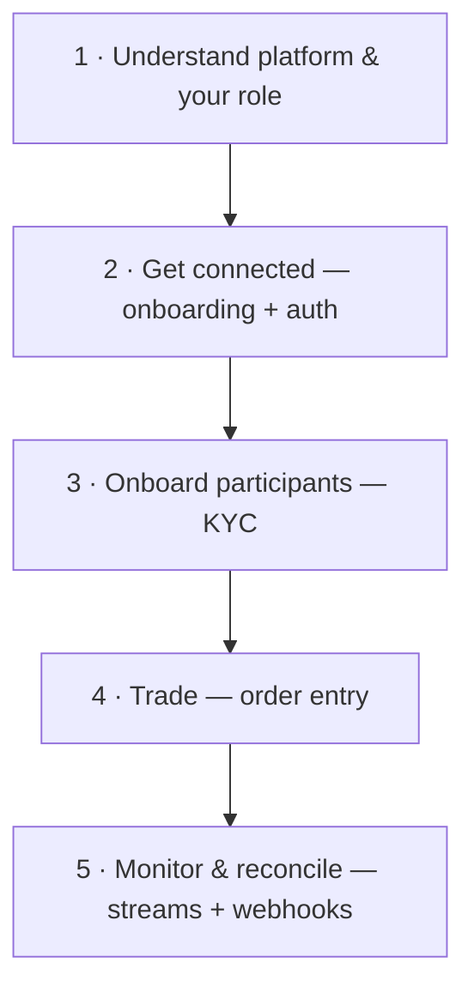

> ## Documentation Index
> Fetch the complete documentation index at: https://docs.polymarket.us/llms.txt
> Use this file to discover all available pages before exploring further.

# Partner Integration

> Build a trading experience on Polymarket US as an Introducing Broker or Independent Software Vendor.

This section is for **Introducing Brokers (IBs)** and **Independent Software Vendors (ISVs)** building a trading experience on Polymarket US. It teaches the **workflow** — how to onboard yourself, onboard and verify your users, fund their trading, place orders, and monitor activity — and points you to the exact APIs and streams for each step.

> [!NOTE]
>
> **New here?** Read [Your Role](https://docs.polymarket.us/partners/your-role.md) and the [Platform Model](https://docs.polymarket.us/partners/platform-model.md) first, then follow the [Integration Journey](https://docs.polymarket.us/partners/integration-journey.md).

## Entity Clearing Member Agreement

> **[Entity Clearing Member Agreement](https://drive.google.com/uc?export=download\&id=1YDjx79uDApWGQBWtHKagc4H0FCmeTnjR)**
>
> Download the Entity Clearing Member Agreement for Polymarket Clearing

## The integration journey

## Which partner are you?

> **[ISV](https://docs.polymarket.us/partners/partner-types/isvs.md)**
>
> An Independent Software Vendor provides the software experience for retail traders. Not a broker.

> **[IB](https://docs.polymarket.us/partners/partner-types/ibs.md)**
>
> An Introducing Broker integrates the same way, plus carries CFTC/NFA regulatory obligations.

> **[FCM](https://docs.polymarket.us/partners/partner-types/fcms.md)**
>
> A Futures Commission Merchant connects and clears differently. See the FCM guide.

> [!NOTE]
>
> IBs and ISVs **integrate identically** — same APIs and same workflow. The difference is legal classification. FCMs are handled separately.

## If you're asking…

| Question | Go to |
| - | - |
| "What does a partner actually do?" | [Your Role](https://docs.polymarket.us/partners/your-role.md) |
| "How is Polymarket US structured?" | [Platform Model](https://docs.polymarket.us/partners/platform-model.md) |
| "What's the end-to-end build order?" | [Integration Journey](https://docs.polymarket.us/partners/integration-journey.md) |
| "How is funding handled?" | [Partner Funding](https://docs.polymarket.us/partners/funding/overview.md) *(Beta)* |
| "How do I authenticate?" | [Authentication](https://docs.polymarket.us/partners/get-connected/authentication.md) |
| "How do I onboard and verify a user?" | [KYC Verification](https://docs.polymarket.us/partners/onboarding/kyc/overview.md) |
| "How do I place my first order?" | [Quickstart](https://docs.polymarket.us/partners/get-connected/quickstart.md) |
| "What does a term mean?" | [Partner Glossary](https://docs.polymarket.us/partners/glossary.md) |

## Get started

> **[Start the Integration Journey](https://docs.polymarket.us/partners/integration-journey.md)**
>
> The recommended path from onboarding to live trading.

> [!NOTE]
>
> **Ready to onboard?** Contact [institutional@polymarket.us](mailto:institutional@polymarket.us) to begin. See [Partner Onboarding](https://docs.polymarket.us/partners/get-connected/onboarding.md) for what we need from you and what you'll receive.

This documentation is built and hosted on [Mintlify](https://mintlify.com), a developer documentation platform.